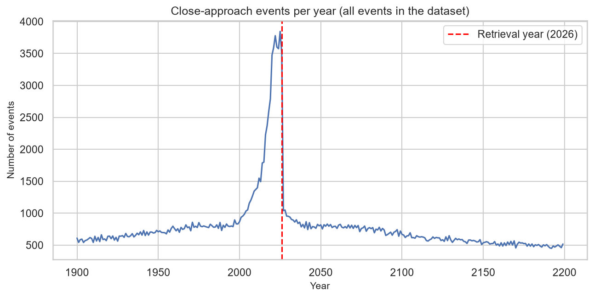
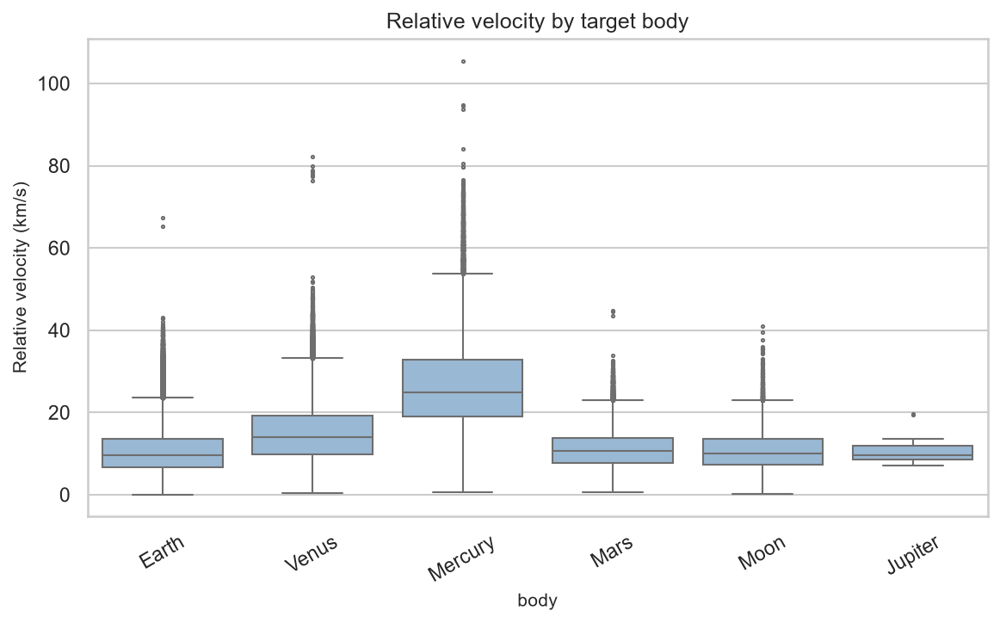
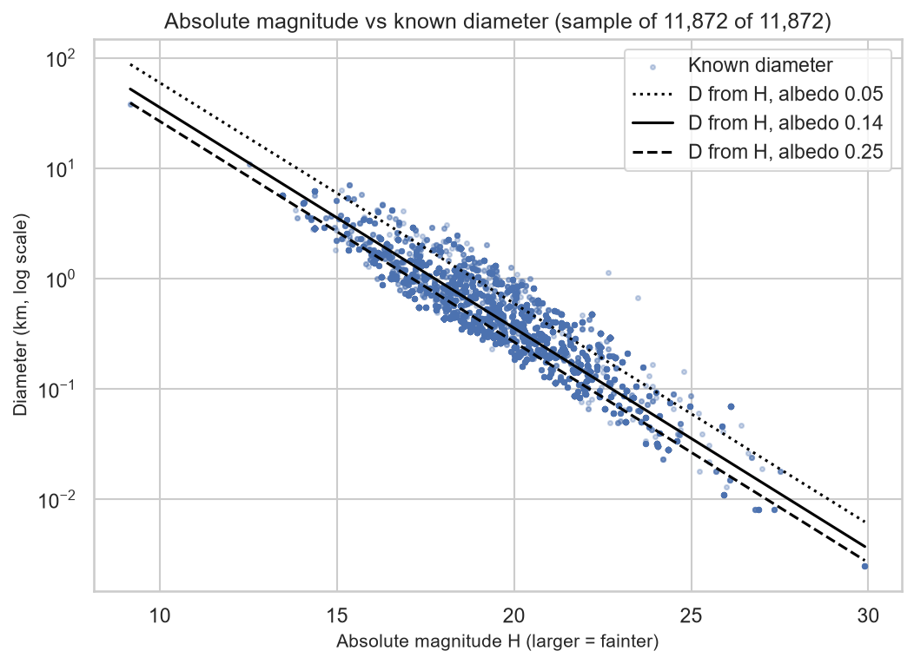
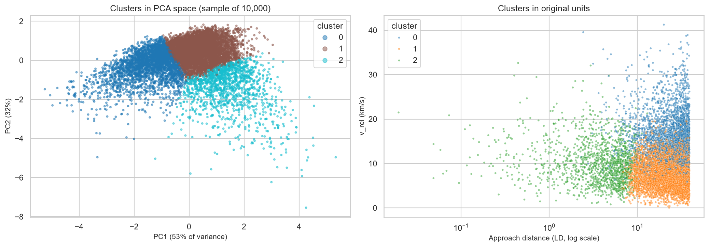
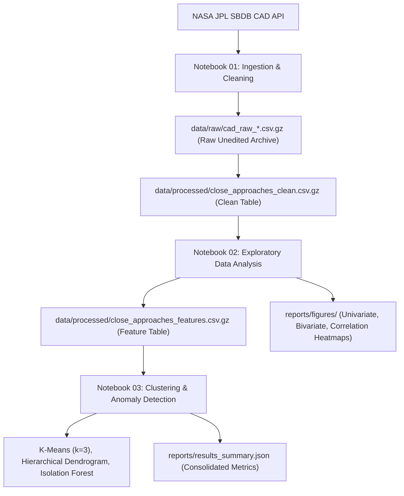

# NASA Asteroid & Comet Close-Approach Analysis

[](https://www.python.org/)
[](LICENSE)
[](https://ssd-api.jpl.nasa.gov/doc/cad.html)
[](notebooks/)
[]()

A comprehensive, reproducible **Exploratory Data Analysis (EDA)** and **Unsupervised Machine Learning** project investigating planetary close-approach events of Near-Earth Objects (NEOs). The dataset was programmatically acquired from NASA Jet Propulsion Laboratory's (JPL) official **Small-Body Database (SBDB) Close-Approach Data (CAD) API**.

The analysis spans **238,760 planetary close encounters** involving **33,426 distinct Near-Earth Objects** across a 300-year epoch (1900–2199 UTC) bounded at 0.1 astronomical units ($\approx 38.92\text{ Lunar Distances}$).

> ⚠️ **Scientific Boundary & Disclaimer:** This project is purely descriptive and educational. **Nothing in this repository predicts asteroid impact probability or forecasts planetary collisions.** Impact hazard monitoring requires high-precision orbital covariance integration, which is the specialized domain of NASA/JPL's automated [Sentry System](https://cneos.jpl.nasa.gov/sentry/).

---

## 📸 Visual Highlights

| Discovery Timeline & Survey Artifacts | Planetary Encounter Velocities |
| :---: | :---: |
|  |  |
| *Modern sky surveys cause an exponential discovery peak in 2021–2025 ($3,845$ events in 2025).* | *Mercury exhibits the highest median speeds ($24.86\text{ km/s}$) due to the Sun's gravity well.* |

| Magnitude vs. Measured Diameter | Unsupervised K-Means Clusters |
| :---: | :---: |
|  |  |
| *Empirical data aligns strictly with theoretical optical albedo curves ($p_V \in [0.05, 0.25]$, $\rho = -0.872$).* | *Three distinct dynamical cohorts: Faint Distant (55.5%), Bright High-Velocity (29.7%), and Close Grazers (14.9%).* |

---

## 📊 Key Findings & Empirical Results

| Domain | Key Metric / Observation | Empirical Finding |
| :--- | :--- | :--- |
| **Catalog Scope** | Total CAD Event Records | **238,760 events** (125,736 historical, 113,024 future) |
| | Unique Asteroids & Comets | **33,426 distinct NEOs** (Median: 3 events/object, Max: 233) |
| **Data Completeness** | Astrodynamical Variables | **100% complete** for `dist`, `v_rel`, `jd`, and `cd` |
| | Photometric Magnitude ($H$) | **99.90% complete** (only 232 values missing) |
| | Physical Diameter | **95.01% missing (MNAR Survivorship Bias)**: drops from 44.52% for bright objects ($H \le 18$) to 0.13% for faint objects ($H > 26$). Naive imputation was rejected. |
| **Planetary Encounters** | Encounter Distribution | **Earth: 50.61%, Venus: 21.60%, Mercury: 12.73%, Mars: 11.83%**, Moon: 3.22% |
| | Kinematic Disparity | Mercury encounters are fastest (median $24.86\text{ km/s}$), while Earth encounters average $9.60\text{ km/s}$. |
| **Correlations** | Distance vs. Relative Speed | **$\rho = +0.051$ (Orthogonal)**: Close flyby distance does not dictate velocity. |
| | Magnitude ($H$) vs. Diameter | **$\rho = -0.872$, OLS slope $\beta_1 = -0.203$**: Matches Pogson theoretical slope ($-0.200$). |
| **Machine Learning** | K-Means Partition ($k=3$) | **Silhouette: 0.3553, Stability ARI: 0.9953**: Discovers faint distant passes, bright high-energy objects, and sub-lunar flybys. |
| | Isolation Forest (1% Contamination) | **1,207 extreme anomalies**: Median distance $0.63\text{ LD}$, median speed $20.13\text{ km/s}$, median $H=27.90$. |

---

## 🏗️ Repository Architecture

```text
nasa-asteroid-close-approach-analysis/
├── README.md                  <- Project overview, empirical findings, and setup guide
├── EXPLANATION.md             <- Plain-English walkthrough, function documentation, and viva prep
├── requirements.txt           <- Production dependencies
├── LICENSE                    <- MIT License
├── .gitignore                 <- Prevents committing multi-megabyte raw/processed data caches
├── notebooks/
│   ├── 01_data_collection_and_cleaning.ipynb   <- API pagination, schema parsing, and data cleaning
│   ├── 02_exploratory_data_analysis.ipynb      <- Univariate, bivariate, temporal, and outlier analysis
│   └── 03_clustering_anomaly_detection.ipynb   <- K-Means, Isolation Forest, and descriptive groups
├── src/                       <- Modular helper packages
│   ├── __init__.py
│   ├── nasa_api.py            <- NASA JPL REST API pagination and caching
│   ├── cleaning.py            <- 8-stage data cleaning and validation pipeline
│   ├── features.py            <- Distance unit conversion, speed gain, and temporal features
│   └── visualization.py       <- Publication-grade Matplotlib/Seaborn visual routines
├── data/
│   ├── raw/                   <- Raw JSON/CSV API downloads (tracked via .gitkeep)
│   ├── processed/             <- Cleaned datasets and feature tables (tracked via .gitkeep)
│   └── sample/
│       └── sample_close_approaches.csv <- 500-row sample for quick inspection on GitHub
└── reports/
    ├── figures/               <- All 21 high-resolution generated figures (PNG)
    └── results_summary.json   <- Machine-readable summary of statistical metrics
```

---

## 🔄 End-to-End Workflow Pipeline



---

## 🚀 Quickstart & Setup Guide

### Prerequisites
* **Python:** 3.10, 3.11, or 3.12
* **Git:** Installed on your system
* **Disk Space:** ~1 GB free (for Python virtual environment and dependencies)

### Installation Steps

1. **Clone the repository:**
   ```bash
   git clone https://github.com/<your-username>/nasa-asteroid-close-approach-analysis.git
   cd nasa-asteroid-close-approach-analysis
   ```

2. **Create and activate a virtual environment:**
   * **Windows (Command Prompt):**
     ```cmd
     python -m venv .venv
     .venv\Scripts\activate
     ```
   * **Windows (PowerShell):**
     ```powershell
     python -m venv .venv
     .venv\Scripts\Activate.ps1
     ```
   * **macOS / Linux:**
     ```bash
     python3 -m venv .venv
     source .venv/bin/activate
     ```

3. **Install required dependencies:**
   ```bash
   pip install --upgrade pip
   pip install -r requirements.txt
   ```

4. **Launch Jupyter Lab:**
   ```bash
   jupyter lab
   ```

### Running the Notebooks

Execute the notebooks sequentially (01 → 02 → 03) because each step builds upon data generated by the preceding stage:

1. **`notebooks/01_data_collection_and_cleaning.ipynb`:**
   * Automatically executes the query ladder against the NASA CAD API, downloads 238,760 events page by page, and cleans the dataset.
   * *Offline / Re-run mode:* If raw data is already present in `data/raw/`, toggle `REUSE_LATEST_RAW = True` in Cell 2 to skip downloading and clean immediately.
2. **`notebooks/02_exploratory_data_analysis.ipynb`:**
   * Generates summary statistics, IQR outlier fences, correlation matrices, and time-series discovery distributions.
3. **`notebooks/03_clustering_anomaly_detection.ipynb`:**
   * Filters Earth encounters, scales features, fits K-Means ($k=3$), constructs Ward's hierarchical dendrogram, and flags anomalies using Isolation Forest.

---

## 📖 Column Data Dictionary

| Attribute | Physical Meaning | Native Units |
| :--- | :--- | :--- |
| `des` | Primary small-body designation or provisional IAU identifier | Text |
| `orbit_id` | JPL orbit solution reference key | Text |
| `jd` | Julian Date epoch of closest approach | Days (TDB) |
| `cd` | Calendar timestamp of encounter (\texttt{YYYY-Mon-DD HH:MM}) | UTC / TDB |
| `dist` | Nominal (best-estimate) closest approach distance | Astronomical Units (au) |
| `dist_min`, `dist_max` | Lower and upper $3\sigma$ astrometric distance confidence bounds | Astronomical Units (au) |
| `v_rel` | Relative velocity vector magnitude at closest approach | km/s |
| `v_inf` | Hyperbolic excess velocity at infinite separation ($v_\infty$) | km/s |
| `t_sigma_f` | $3\sigma$ encounter timing uncertainty window | String / Days |
| `body` | Target planet or moon approached (e.g., Earth, Venus, Mars) | Categorical |
| `h` | Absolute optical magnitude ($H$ parameter in HG magnitude system) | Magnitudes (mag) |
| `diameter`, `diameter_sigma` | Measured spherical equivalent physical diameter and uncertainty | Kilometers (km) |
| `fullname` | Complete astronomical name and catalog designation | Text |

---

## 🔍 Technical Details & Code Design

* **Modularity:** Notebooks do not contain raw monolithic boilerplate; core logic is abstracted into clean, reusable Python modules inside [`src/`](src/).
* **Data Integrity:** Raw downloads in `data/raw/` are immutable and strictly read-only. Cleaned outputs in `data/processed/` are derived deterministically.
* **Reproducibility:** All random seeds are fixed (`seed=42`) across train/test splits, K-Means initializations, and Isolation Forest tree ensembles.
* **Beginner-Friendly:** For a complete plain-English explanation of all algorithms, statistical formulas, and code mechanics, consult **[`EXPLANATION.md`](EXPLANATION.md)**.

---

## 📜 License & Acknowledgments

* **Code License:** [MIT License](LICENSE) © 2026 NASA Asteroid Close-Approach Analysis Contributors.
* **Data Provenance:** Courtesy of **NASA/JPL Solar System Dynamics Group** and the **Center for Near Earth Object Studies (CNEOS)**, [Small-Body Database CAD API](https://ssd-api.jpl.nasa.gov/doc/cad.html).
* **Scientific References:**
  - Harris, A. W. (2002). *A New Method to Estimate the Diameter of Asteroids from Absolute Magnitude and Albedo*. Icarus, 156(1), 135–146.
  - Bowell, E. et al. (1989). *Application of Photometric Models to Asteroids*. Asteroids II, 524–556.
  - Liu, F. T., Ting, K. M., & Zhou, Z.-H. (2008). *Isolation Forest*. IEEE ICDM, 413–422.
  - Rousseeuw, P. J. (1987). *Silhouettes: A Graphical Aid to the Interpretation and Validation of Cluster Analysis*. JCAM, 20, 53–65.
